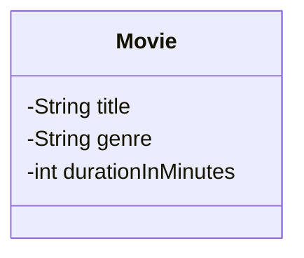
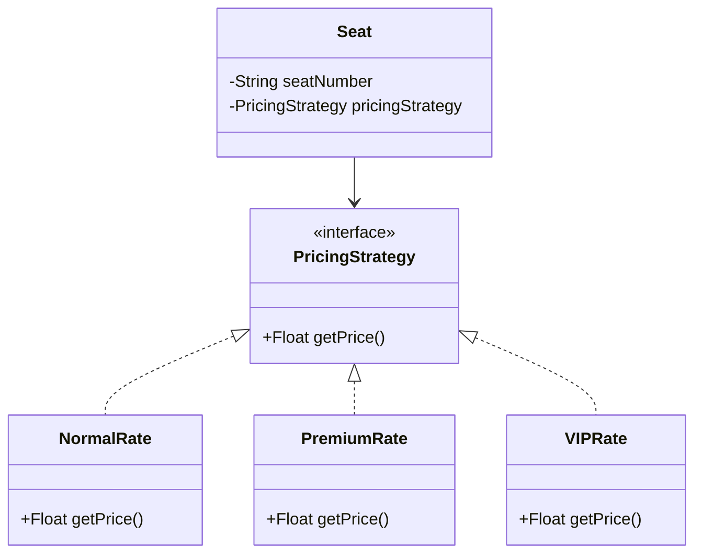
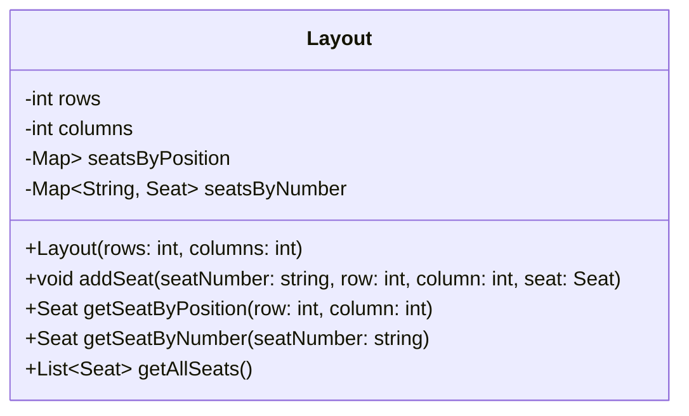
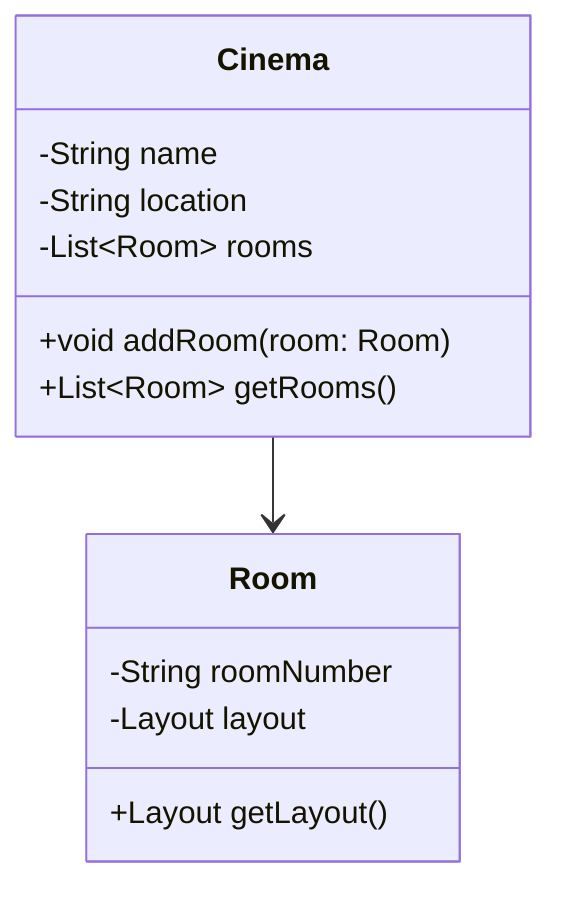
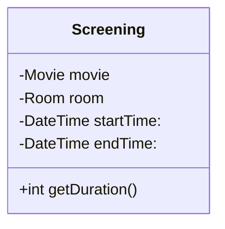
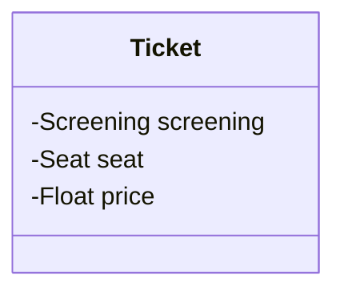
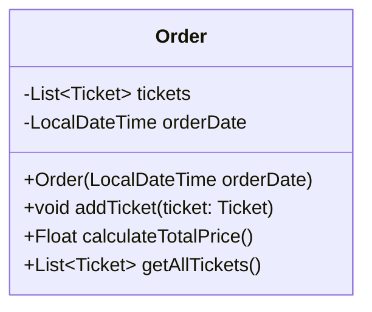
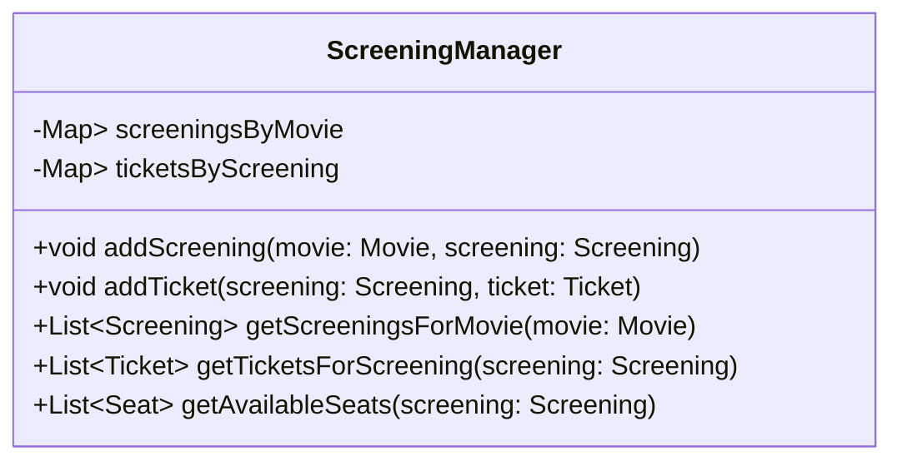
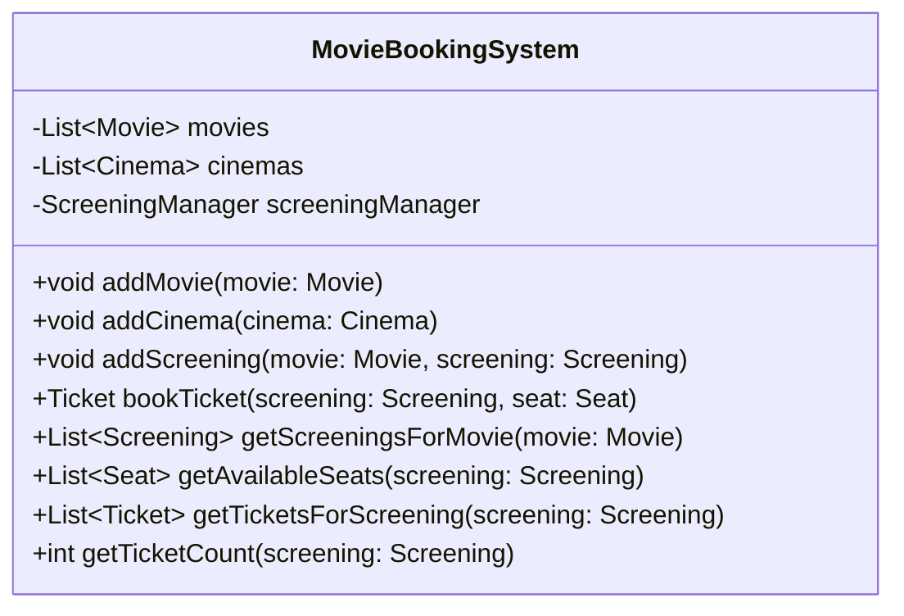
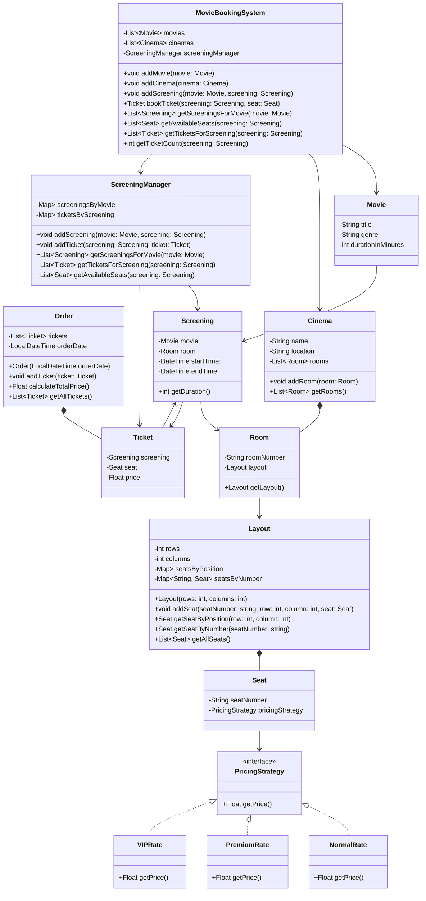

# Movie Ticket Booking System

## Functional Requirements

### Movie and screening management
- Each cinema is located at a specific location and contains multiple rooms
- Movies can have multiple screenings scheduled across different rooms, cinemas, and time slots

### Seat management and pricing
- Each room has a grid of seats available for booking
- Seats within a room can have varying pricing strategies (e.g., normal, premium, VIP) that affect ticket prices

### User search and book flow
- Users can search and book available tickets
- A ticket represents a specific seat to watch a movie in a room at a particular time
- A user can book multiple tickets within the same order
- The total cost for an order is computed by summing the prices of all selected seats, based on their pricing tiers

## Non-functional requirements
- Fast searches for screenings for a smooth user experience
- Basic error handling should prevent booking conflicts, such as double-booking the same seat (race condition)

## Core Objects
- `Movie`: Represents a specific movie shown in cinemas, capturing its essential details like title, duration and genre.
- `Cinema`: Represents a physical location where movies are screened, containing multiple rooms for different screenings.
- `Room`: Represents a specific screening space within a cinema, tied to a unique layout of seats. Room is separate from the layout to allow rooms to share or customize seating arrangements, enhance flexibility.
- `Layout`: Organizes the seating arrangement in a room as a grid, managing seat positions.
- `Seat`: Represents an individual seat within a room linked to a pricing strategy.
- `Screening`: Combines a movie, room and a time slot to define when and where a movie is shown.
- `Ticket`: Represents a booked seat for a specific screening, associated with a user and a price based on the seat's pricing strategy.
- `Order`: Represents a collection of tickets booked by a user, calculating the total cost based on the individual ticket prices.
- `ScreeningManager`: Manages key operations, such as searching for screenings of specific movies, identifying available seats, and storing purchased tickets.
- `MovieBookingSystem`: The main application class that orchestrates the overall booking process, integrating the various components and managing user interactions.

## Class Diagram

### Movie
The Movie class captures essential details about a specific movie in the system. It focuses on static information, title, genre, and duration, data that remains constant across all screenings of that film. It stands apart from a Screening, which ties a movie to a room and time slot for a particular showing

### Seat
The Seat class holds key details about an individual seat, including its unique number. It uses the strategy pattern, implemented through the PricingStrategy interface with concrete classes like `NormalRate`, `PremiumRate`, and `VIPRate`, to manage price calculation flexibly.\
The strategy pattern benefits the system in two key ways:
- It promotes extensibility, making it easy to add new rate classes.
- It reduces code redundancy by using a single Seat class for all pricing variations. 

### Layout
The Layout class acts as a bridge between individual seats and cinema rooms. It organizes seats into a grid structure defined by rows and columns. It uses a nested map `Map<Integer, Map<Integer, Seat>>` for efficient seat lookup, where the outer map's key is the row number, the inner map's key is the column number within that row, and the value is the Seat object at that position (row → column → seat). \
It also maintains an index `Map<String, Seat>` to locate seats by their seat numbers quickly. This design simplifies managing seats across multiple theater rooms, ensuring easy access to seat data for booking purposes.

### Cinema & Room
Cinema and Room classes structure the cinema system by leveraging the seat and layout framework. A cinema contains multiple rooms, each with its own layout of seats. 

### Screening
With the cinema structure in place, the Screening class defines a specific showing of a movie in a particular room at a scheduled time. It combines a Movie, a Room, and time details into a single entity.

### Ticket
The Ticket class represents a purchased seat for a specific Screening, combining a Screening and a Seat. It includes a price attribute, capturing the seat's cost at the time of purchase. This design, despite the Seat class using a strategy pattern for pricing, ensures the ticket price remains fixed, independent of any future changes to the seat's pricing strategy.

### Order
The Order class groups multiple tickets into a single transaction, capturing all tickets purchased together at a specific time. It tracks the order's timestamp and provides the total cost of the tickets.

### ScreeningManager
Modeling classes like Movie, Seat, and Ticket alone does not create a complete system. To address this, we design a ScreeningManager class that manages key operations, such as searching for screenings of specific movies, identifying available seats, and storing purchased tickets.

### MovieBookingSystem
The MovieBookingSystem class is the final piece that brings all components together. It integrates the list of movies, cinema locations, and an instance of ScreeningManager into a cohesive system. It acts as a facade, streamlining user interactions by delegating tasks to underlying classes like ScreeningManager, Movie, and Cinema. Through MovieBookingSystem, key operations, such as adding movies or cinemas, finding screenings for a movie, checking available seats, and booking tickets, are centralized. This design enhances usability by offering a single entry point for these functions while preserving modularity, as each task remains handled by its respective class.

#### Complete Class Diagram
